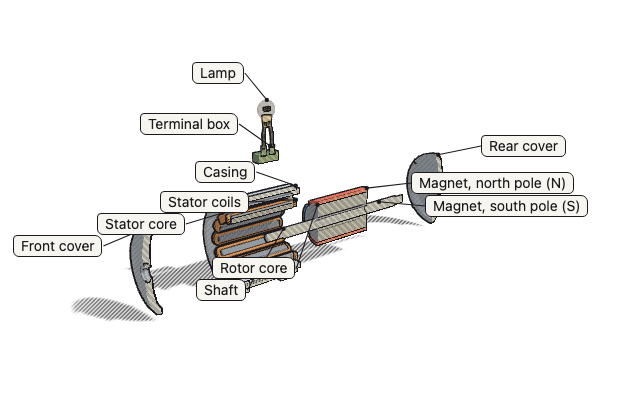

# lk3d

A small engine for **explorable, accessible 3D diagrams built from data**: a machine, a cell, a molecule, an optical
bench, a fossil. Readers turn it, take it apart, cut it open, point at a part to read about it, and move parts by hand.
The scene is plain data (JSON), so it can be written, reviewed and checked like text.



```html
<div id="fig"></div>
<script src="https://unpkg.com/lk3d/dist/lk3d.min.js"></script>
<script>
  LK3D.mount(document.getElementById('fig'), {
    title: 'A bolt and a nut',
    parts: [
      {
        id: 'bolt',
        name: 'Bolt',
        note: 'its thread turns into the nut.',
        material: 'steel',
        color: '#9aa3ad',
        shapes: [{ cylinder: { r: 0.12, x0: -0.8, x1: 0.6 } }, { cylinder: { r: 0.22, x0: -0.95, x1: -0.8 } }],
      },
      {
        id: 'nut',
        name: 'Nut',
        note: 'screws onto the end of the bolt.',
        material: 'steel',
        color: '#c0c6cc',
        explode: [0.6, 0, 0],
        shapes: [{ cylinder: { r: 0.24, ri: 0.12, x0: 0.2, x1: 0.36 } }],
      },
    ],
  });
</script>
```

## What it does

- **Explore**: turn, zoom, pan (mouse, touch, pen, keyboard); preset views; take the model apart (each part along its
  own path); cut it open, with the cut faces filled and hatched; see through casings; labels with leader lines that do
  not overlap; a note for each part.
- **Move parts by hand**: handles that turn (a focus ring, a rotor), slide (a piston, an object on a bench) or follow a
  path (a planet on its orbit), each also a range input for the keyboard and screen readers. Rays, field lines and
  forces as lines; streaks of air or blood flowing along paths, coloured cool to hot, as many and as fast as a page
  value says ([flow](docs/handles-and-lines.md#flow)); particles along paths; solid balls a simulation places.
- **Liquids and gases by their laws**: a liquid fills its vessel to the level its volume gives, by the vessel's own
  shape, and pours through an open stopcock by Torricelli's law into the vessel below, as a falling stream; liquids
  stack by density; a gas holds its piston where pV = nRT puts it; warm air rises as a buoyant plume
  ([liquids and gases](docs/fluids.md)).
- **Shapes from a few numbers**: lathes, cylinders, tubes, coils, windings, blades for machines; cells, membranes,
  branching trees, molecules in CPK colours, DNA, rock layers, orbits for the sciences ([catalogue](docs/shapes.md)).
  glTF models for what generated shapes cannot draw, textured scans included ([models](docs/models.md)).
- **Three looks, four themes**: a clean pen look by default (light solids, thin outlines and edges, a soft shadow,
  colour where it matters), a realistic studio look (physically based materials, a generated environment, soft
  shadows, surface detail, glass that bends light) and a hand-drawn ink look, with an orthographic camera for a
  technical illustration; light, dark, blueprint and sepia themes, or the reader's own setting
  ([looks](docs/looks-and-materials.md)).
- **Honest scale**: a scale bar that keeps its true length as the view zooms, or a note saying what is not to scale.
- **Accessible**: the figure has a text description, every control works by keyboard, handles are read out, motion
  respects reduced-motion settings, English and Vietnamese words built in (add your own), themed by CSS variables.
- **Checked**: a JSON Schema for scenes and a validator that says what is wrong where ([format](docs/scene-format.md));
  a geometry check that finds parts running into each other when taken apart, parts hanging in the air and hidden
  labels; TypeScript types.
- **Made for AI agents too**: `npx lk3d check scene.json` and `npx lk3d render scene.json` (PNG pictures of each look
  and pose, to look at), and an [Agent Skill](skill/lk3d/SKILL.md) that teaches an agent to build detailed, clean,
  correct figures.

## Small and fast

|                                                                                                                                   | Minified | Gzipped |
| --------------------------------------------------------------------------------------------------------------------------------- | -------- | ------- |
| lk3d                                                                                                                              | 135 KB   | 54 KB   |
| three.js r187, the smallest page                                                                                                  | 522 KB   | 131 KB  |
| three.js r187 with what lk3d does (PBR and glass, shadows, environment, controls, picking, glTF, labels, bloom, shape generators) | 708 KB   | 181 KB  |

It draws only when something changes, pauses off screen, lowers its resolution while frames run late, compiles its
realistic shaders in the background, never reads back from the GPU or the page layout while drawing, and falls back
from WebGL 2 to WebGL 1 to Canvas 2D. On a laptop every example scene holds a 120 Hz screen's rate with under 1 ms of
script per frame ([performance](docs/performance.md)); phones are still to be measured on more devices.

## When not to use it

lk3d explains objects. For games, character animation (skins, morph targets), VR and AR, custom shaders or general 3D
scenes, use [three.js](https://threejs.org) or [Babylon.js](https://www.babylonjs.com); to show a single glTF model
with hotspots and AR, use [model-viewer](https://modelviewer.dev).

## Use it

```sh
npm install lk3d
```

```js
import LK3D from 'lk3d'; // or <script src=".../dist/lk3d.min.js"> for the global LK3D
import { validate } from 'lk3d/validate'; // check a scene's form before showing it (and lk3d/lint: its geometry)
const fig = LK3D.mount(el, scene, { info: document.querySelector('#info'), onHandle: (id, v) => console.log(id, v) });
fig.set({ explode: 1 });
```

- [API](docs/api.md): `mount`, its options and the figure's methods.
- [Scene format](docs/scene-format.md) · [Shapes](docs/shapes.md) · [Handles and lines](docs/handles-and-lines.md) ·
  [Looks and materials](docs/looks-and-materials.md) · [Models](docs/models.md) · [How it works](docs/design.md) ·
  [Performance](docs/performance.md).
- [Examples](examples/): a generator, a lens bench, a cell, molecules, the Solar System, rock layers, a gauge, a fossil
  skull, the three looks, a circuit, air through a fan. `npm run examples` serves them.
- From the command line: `lk3d check scene.json` (form and geometry, and the scene's size) and `lk3d render
scene.json --looks pen,ink --poses rest,apart,cut` (pictures drawn by the engine; needs Playwright).

## Develop

```sh
npm install
npm test               # geometry, models, handles, the validator, the geometry check, the skill, the locales
npm run typecheck      # the TypeScript types
npm run size           # the bundle stays within 56 KB gzipped
npm run test:visual    # reference scenes compared with stored pictures, in Chromium, Firefox and WebKit
npm run lint           # ESLint and Prettier
npm run docs           # the scene-format reference and the shape pictures, made again
```

lk3d began as the 3D engine of [lessonkit](../../README.md), which builds verified interactive lessons; it is developed
in that repository and published from `packages/lk3d`.

## Licence

MIT.
