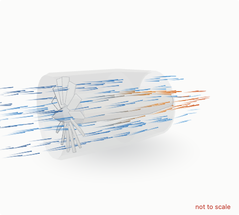

# Handles, lines and flow

## Handles: parts the reader moves

A part with a `handle` moves under the pointer (mouse, finger or pen), held to one rule:

```js
{ turn: { axis: [1, 0, 0], center: [0, 0, 0] }, min: 0, max: 270, snap: 15, label: 'Focus ring' }   // degrees
{ turn: { axis: [1, 0, 0] }, moves: ['rotor'], label: 'Rotor' }        // no min/max: it goes round and round
{ slide: { axis: [1, 0, 0] }, value: -4.5, min: -5.5, max: -0.3, snap: 0.1, moves: ['stand'] }      // a distance
{ along: { path: [[x, y, z], …], closed: true }, label: 'Earth' }       // a place on a path, 0 to 1 of its length
```

- `value` is where the part is drawn (default 0, or `min`); a slide's value is in scene units along its axis.
- `moves` lists other parts or groups carried with it.
- A pointer that lands on a handle moves it; anywhere else it turns the view. Glass in front does not hide a handle, and
  a small one (a planet, a focal point) is caught within a finger's width.
- Each handle is also a hidden range input: Tab reaches it, the arrow keys move it (a turn without stops goes round and
  round), and a screen reader reads its `label` and its value, worded by the page's `handleText`.

The page hears every move the reader makes and can move a handle itself (that does not call `onHandle` back):

```js
const fig = LK3D.mount(el, scene, {
  onHandle: (id, v) => {
    d = -v * 10;
    redraw();
  },
  handleText: (id, v) => `d = ${-v * 10} cm`,
});
fig.handle('object').set(-3);
```

The engine's handle maths (`src/handles.js`: the pointer ray to an angle, a distance or a place on a path) is pure and
tested in Node. Examples: [the lens](../examples/lens.html), [the gauge](../examples/gauge.html),
[the Solar System](../examples/solar.html), [the generator](../examples/generator.html).

## Lines: rays, field lines, forces

```js
const rays = fig.lines({ count: 6, radius: 0.01, color: '#d99a00', studioColor: '#ffcf66', glow: '#ffb030' });
rays.set(0, [x0, y0, z0], [x1, y1, z1]); // segment k from a to b; set(k, null) hides it
rays.glow(0.8);
rays.clear();
```

Each set of lines is one draw: a unit cylinder drawn once per segment by instancing, with its matrices updated in place.

## Flow

Streaks that run along paths: air through an engine, blood along a vessel, water round a bend. Each is a thin ribbon
that fades from its head to its tail, wanders a little round its path (`spread`), and takes its colour from a ramp
along the path, so air can come in cool and leave hot.



```js
// paths round the axis: a profile of [x, radius] turned to eight angles
const around = (profile, n) =>
  Array.from({ length: n }, (_, k) => {
    const a = ((k + 0.5) / n) * 2 * Math.PI;
    return profile.map(([x, r]) => [x, r * Math.cos(a), r * Math.sin(a)]);
  });
const air = fig.flow({ paths: around(BYPASS, 8), count: 500, ramp: 'cool', spread: 0.06, length: 0.1 });
const core = fig.flow({ paths: around(CORE, 6), count: 360, ramp: ['#3a83c6', '#3a83c6', '#e3801f', '#c8461c'] });
throttle.oninput = () => air.set({ amount: 0.15 + 0.85 * t, speed: 0.6 + 3.4 * t }); // more streaks, faster
fig.set({ timeScale: 0.2 }); // slow motion, for flows and particles alike
```

| Option              | Default  | Meaning                                                                                               |
| ------------------- | -------- | ----------------------------------------------------------------------------------------------------- |
| `path` or `paths`   |          | one polyline, or several (the streaks are shared out among them in turn)                              |
| `count`             | 300      | streaks (at most 8000)                                                                                |
| `speed`             | 0        | scene units a second; each streak runs a little faster or slower than that, so they drift apart       |
| `amount`            | 1        | the share of the streaks drawn: tie it to a throttle, a pressure, a heart rate                        |
| `length`            | 0.12     | a streak's length, as a share of its path                                                             |
| `width`             | 1.6      | in CSS pixels, never under 1.25 (thinner streaks flicker as they move)                                |
| `spread`, `opacity` | 0, 0.85  | how far streaks wander from the path (scene units); how strong they are                               |
| `ramp`              | `'cool'` | `'cool'`, `'heat'` (dull red, orange, yellow), one colour, or up to four from the path's start to end |
| `part`, `closed`    |          | a part whose movement the streaks follow; a path that joins up                                        |

How they are drawn follows the page. On a light page the streaks are ink: blended over the picture, never added
(added light washes out into white paper), and the presets end in a strong colour there; on a dark page (a theme
with `dark`, or the studio look) their light is added, and the presets end near white. They fade in and out at an
open path's ends, are hidden by solid parts but seen through glass, and stand still for a reader who asked for less
motion. Every streak's place comes from a fixed seed, so the same flow draws the same picture.

## Streams

Air, gas or liquid as a moving volume: a jet leaving a nozzle, air drawn into an intake, a plume. Where flow streaks
are lines along paths, a stream is a field the GPU draws inside a tube round its path. In the stream's own coordinates
(along the path, distance from it, which way round) it builds filaments that move downstream, broken into runs,
stirred by turbulence and rolled up more towards the edge as the stream goes on.

The air is carried by its travel time: it speeds up where the stream narrows and slows where it widens (by
continuity, speed × area stays the same), stretching as it speeds up and never running backwards. Where continuity is
not the whole story (gas squeezed denser in a compressor, heated in a combustor, a jet slowing as it mixes with still
air), `speeds` gives the speed along the path. The turbulence changes as the air travels, so a stream that stops,
stops changing. It is kinematics, not a fluid simulation: the speeds come from the page. Its colour comes from a ramp along
the path, and it fades in and out at its ends. It stops behind solid parts and is cut with them.

```js
// the hot core jet, widening as it leaves the nozzle; the bypass air as an annulus round it
const core = fig.stream({
  path: [
    [1.9, 0, 0],
    [3, 0, 0],
    [4, 0, 0],
  ],
  radius: [
    [0, 0.37],
    [1, 0.7],
  ],
  ramp: 'heat',
});
const bypass = fig.stream({
  path: [
    [0.6, 0, 0],
    [2.4, 0, 0],
  ],
  radius: [
    [0, 0.5, 0.78],
    [1, 0.4, 0.95],
  ],
  ramp: 'cool',
});
throttle.oninput = () => core.set({ density: 0.3 + 0.7 * t, speed: 1 + 4 * t });
```

| Option                | Default  | Meaning                                                                                           |
| --------------------- | -------- | ------------------------------------------------------------------------------------------------- |
| `path`                |          | the polyline along its middle, 2 to 16 points                                                     |
| `radius`              | 0.1      | one number, or stops `[f, rOut]` or `[f, rIn, rOut]` (f from 0 at the start to 1 at the end)      |
| `speed`, `density`    | 0, 1     | scene units a second where its relative speed is 1 (by continuity: at the start); how thick it is |
| `speeds`              |          | its speed along the path, stops `[f, fraction of speed]`; without them, from continuity           |
| `fade`                | 0.7      | where along the path it starts to fade out                                                        |
| `turbulence`, `swirl` | 0.5, 0.5 | how much the filaments are stirred; how much more towards the edge, growing downstream            |
| `ramp`                | `'cool'` | as for flows                                                                                      |

Streams are drawn at half resolution with 32 samples a pixel, so a page with several large streams costs the GPU more
than streaks do. Without WebGL a stream is drawn as streaks along its path.
