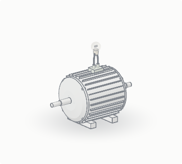
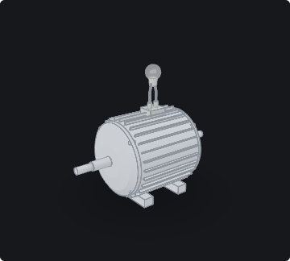
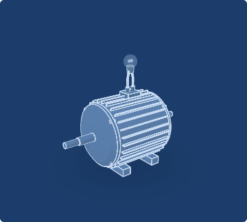

# Looks and materials

## Three looks

| Look                   | WebGL 2                                                                                                                                                                                                                                                                                                                                                                                                                                                | WebGL 1                                                    |
| ---------------------- | ------------------------------------------------------------------------------------------------------------------------------------------------------------------------------------------------------------------------------------------------------------------------------------------------------------------------------------------------------------------------------------------------------------------------------------------------------ | ---------------------------------------------------------- |
| `ink` (default): drawn | three bands of coloured-pencil shading, hatching in the shade, cross-hatching in creases (ambient occlusion), a hatched shadow on the paper, ink outlines, paper grain                                                                                                                                                                                                                                                                                 | the same, with a soft contact shadow instead of a cast one |
| `pen`: plain           | near-white solids lit from the viewer's upper left (the light turns with the camera, so the model always reads the same way): a flat face takes one tone, about 3–4 % from its neighbours, and a curved one shades smoothly; faces turned up a step lighter; thin grey outlines and edges, a soft halo for a ground; a part keeps its colour only when it is an `accent: true` part, glows or is chosen (a vertex's own colour, an atom's, keeps half) | the same                                                   |
| `studio`: realistic    | physically based materials (the lighting model of Google's Filament: GGX, correlated Smith visibility, Schlick Fresnel) lit by a studio environment the engine generates and prefilters on the GPU (no image to download), soft cast shadows, ambient occlusion, a glow around glowing parts, Khronos PBR Neutral tone mapping                                                                                                                         | the same materials with an analytic sky                    |

**Edges.** The pen look draws a thin line wherever a part's faces meet at more than 40°: a box's corners, a step in a
lathe's profile, a fin's rim, an open tube's end. Curved surfaces have none, and soft shapes (models, blobs, trees,
terrain, scatter, molecules, DNA) get none unless their part says `edges: true`; `edges: false` on a part leaves its
edges out, and on the scene leaves out all of them. A scene's `edges: true` draws them in the other looks too. They are
found in idle time after the first picture, only once a look needs them.

**Projection.** `view: { projection: 'ortho' }` (or `set({ projection })`) draws with an orthographic camera:
parallel lines stay parallel, as in a technical illustration. With the pen look and its edges, it is the look of an
exploded-view drawing. The default is perspective.



The Canvas 2D fallback draws flat shading in the same bands, with coarser shapes and no edges; labels, picking and
handles still work. The reader goes round the looks with the built-in button; `style` sets the first, and a look lk3d does not know
is drawn as `ink`. The studio environment and the glow are made only
when first needed, and their shaders compile in the background where the browser can.

## Themes

A theme sets the page behind the model, the lines, the words on the stage and the pen look's solids, in any look:
`theme: 'light'`, `'dark'`, `'blueprint'` (pale lines on blue) or `'sepia'` in the scene, the `theme` mount option or
`set({ theme })`; `'auto'` follows the reader's system (light or dark). With no theme, `ink` and `studio` keep their
own colours (the drawn look on the page's paper, the studio look before its environment) and `pen` takes `light`.

 

A theme draws its page colour into the canvas, and sets the figure's `--lk3d-*` variables on the stage itself, so the
labels, leader lines and notes follow it. Add a theme of your own to `LK3D.themes` and use it by name:

```js
LK3D.themes.slate = { ...LK3D.themes.dark, bg: '#20262e', solid: '#b8c2cc' };
```

Its colours: `bg` (the page), `ink` (the words), `line` (outlines, leader lines, label borders), `paper` (label
backgrounds), `muted` (hints), `warn` (the "not to scale" note), `highlight` (a chosen label), `solid` and `shadow`
(the pen look's solids and ground), and `dark` (true when the page is dark: light is then added, as glows and
streaks, rather than inked).

## Materials

`metal`, `steel`, `copper`, `gold`, `plastic`, `rubber`, `paint` (the default), `glass`, `magnet`, `matte`, `wood`,
and for the sciences `tissue`, `membrane`, `skin`, `bone`, `rock`, `soil`, `ice`, `water`, `gas`. Soft ones (tissue,
membrane, skin, gas, a little bone and ice) let light wrap round into the shade and glow faintly at the rim, as light
passing into soft matter does. `color` is the drawn and pen looks' colour, `studioColor` the studio look's; `opacity` makes a
part see-through; `xray: true` makes it see-through with the "See through" control.

## The studio look's detail (WebGL 2)

- **Surface detail**, at no cost in data: `surface: { kind, scale, strength }`, with `kind` one of `brushed` (streaks
  along x), `knurl` (a diamond grip round x), `ribs` (grooves round x), `grain` (rock, wood), `skin` (cells,
  membranes), `cast` (sandy cast metal); `scale` is bumps per unit, `strength` 0.3 to 1. A height in the part's own
  coordinates bends the normals through its screen derivatives; parts without a surface pay nothing.
- **Glass that bends the light**: `refract: 1` on a `material: 'glass'` part (0 to 2; a lens 1, a bulb 0.6). The
  picture behind the glass is copied once per frame and sampled where the surface sends it.
- **Environments**: `env: 'studio'` (default), `'warm'` or `'night'` (a dim, cool sky).

The drawn look, WebGL 1 and the 2D fallback draw without these.

## Honest scale

A scene drawn to scale can show a bar that keeps its true length as the reader zooms, `scale: { bar: { length: 0.5,
label: '5 µm' } }`; a scene that is not to scale can say so on the stage, `scale: { note: 'Not to scale' }`; or both.
