# Shapes

Every part is made of shapes generated from a few numbers: no model files. Random choices come from a `seed`, so a
scene is the same every time; detail follows the device (coarser on phones and in the 2D fallback). A `model` shape
brings in a glTF model instead ([models](models.md)).

|                                    | Shape                                                                                        | Makes                                                                                                                  | Also                                                       |
| ---------------------------------- | -------------------------------------------------------------------------------------------- | ---------------------------------------------------------------------------------------------------------------------- | ---------------------------------------------------------- |
| 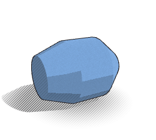         | `lathe: [[x, r], …]`                                                                         | a body of revolution around the x axis from a profile of (position along x, radius); drawn either way round            | `closed` (a ring), `from`/`to` (a sector), `mirror`, `seg` |
| 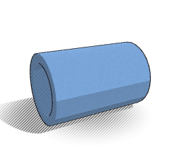   | `cylinder: {r, x0, x1, ri, r1}`                                                              | a cylinder along x; `ri` makes it hollow, `r1` a cone                                                                  |                                                            |
| 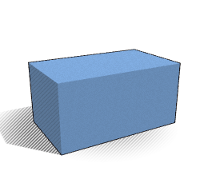             | `box: [sx, sy, sz]`                                                                          | a box, centred                                                                                                         |                                                            |
| 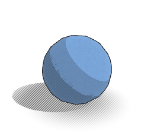       | `sphere: r`                                                                                  | a sphere                                                                                                               | `seg` (32; 8 for a tiny bead)                              |
| 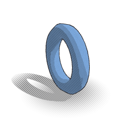         | `torus: [R, r]`                                                                              | a ring around the x axis                                                                                               |                                                            |
| 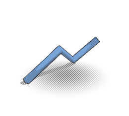           | `tube: [[x, y, z], …]`                                                                       | a round wire along a path                                                                                              | `r`, `closed`                                              |
| 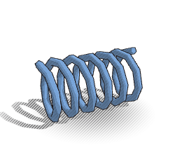         | `helix: {r, x0, x1, turns, wire}`                                                            | a coil along x                                                                                                         |                                                            |
| 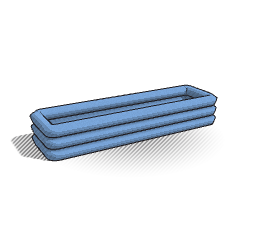           | `loop: {a, b, R, wire, corner, turns, gap}`                                                  | a rounded rectangular winding at height R (a coil round a stator tooth)                                                |                                                            |
| 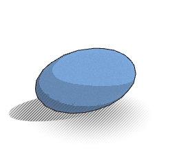 | `ellipsoid: [a, b, c]`                                                                       | an egg shape: a cell, a nucleus, a seed (semi-axes)                                                                    |                                                            |
| 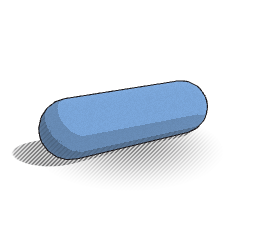     | `capsule: {r, x0, x1}`                                                                       | a rod with round ends: a mitochondrion, a bacterium                                                                    |                                                            |
| 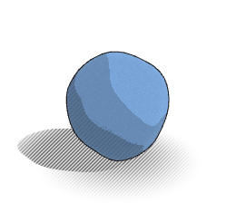           | `blob: {r, amp, freq, seed, stretch}`                                                        | an irregular round body: a cell body, a rock, a small moon                                                             |                                                            |
| 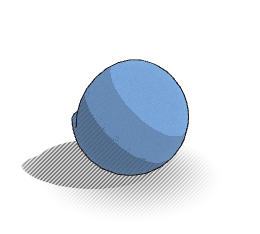         | `shell: {r, ri, from, to}`                                                                   | a sphere hollow inside `ri`, a wedge cut away: a membrane, Earth's layers                                              | `ri: 0` for a solid core                                   |
| 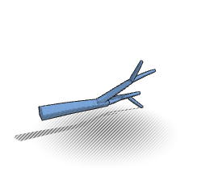           | `tree: {at, dir, length, r, levels, branches, spread, shrink, taper, bend, seed}`            | branching, tapering tubes: dendrites, vessels, roots                                                                   |                                                            |
| 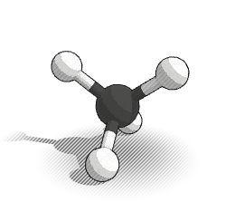   | `molecule: {atoms: [{el, at}], bonds: [[i, j, order]], scale, style}`                        | atoms in CPK colours, bonds in the two atoms' colours, double and triple bonds; positions in ångström                  | `style: space` (space-filling)                             |
| 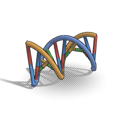             | `dna: {pairs, seq, scale}`                                                                   | a double helix with A–T and G–C base pairs, along x                                                                    |                                                            |
| 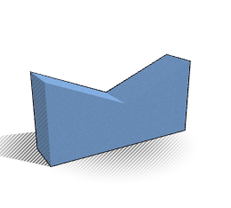     | `extrude: {outline, depth}`                                                                  | a flat outline made solid (concave is fine): a fault block, a Golgi cisterna                                           |                                                            |
| 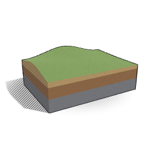     | `terrain: {size, res, base, height: {amp, freq, seed}, layers: [{thick, color}], top, tilt}` | a block of ground: a landscape on top, rock layers on the sides                                                        | `tilt` dips the layers                                     |
| 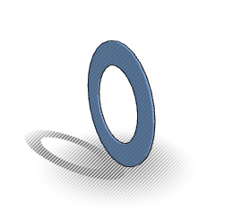           | `ring: {r, ri, thickness}`                                                                   | a flat ring: Saturn's rings                                                                                            |                                                            |
| 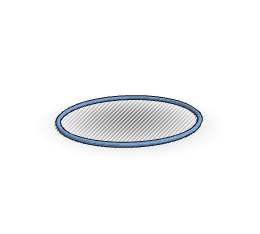         | `orbit: {a, e, wire}`                                                                        | an ellipse with the Sun at a focus                                                                                     |                                                            |
| 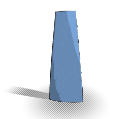         | `blade: {root, span, chord, tip, twist, thickness, camber, sweep}`                           | a twisted airfoil blade along y: fans, compressors, turbines (repeat it around x)                                      |                                                            |
| 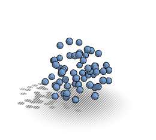     | `scatter: {shape, n, within, avoid, size, seed}`                                             | copies of a shape at random places in a sphere, shell or box (avoiding regions): ribosomes, stars; drawn by instancing |                                                            |

## Placing shapes

Every shape also takes `at`, `rot` (degrees), `scale` (`[x, y, z]` or one number), `color` (its own colour over the
part's), `detail` (0.5 for a shape repeated hundreds of times, 2 for a close-up) and `repeat: n` or
`{n, step, start, axis}` for copies round an axis: blades, teeth, coils, fins. Copies that are only turned and evenly
scaled are drawn by instancing (one geometry, one draw); a mirrored or stretched copy keeps its faces pointing out and is
merged into the part instead. The pictures are made by `npm run docs`.
